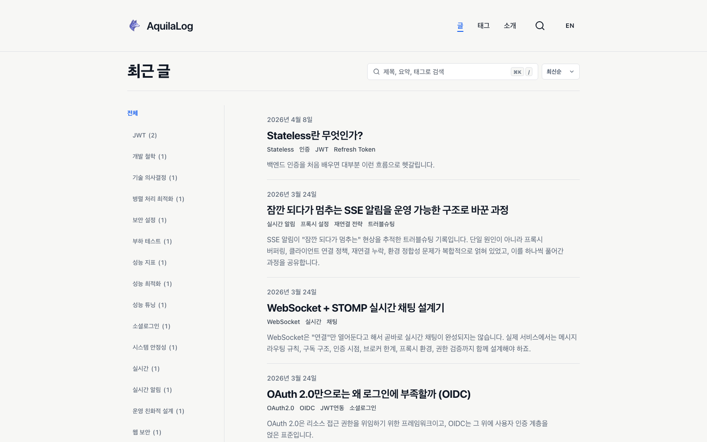
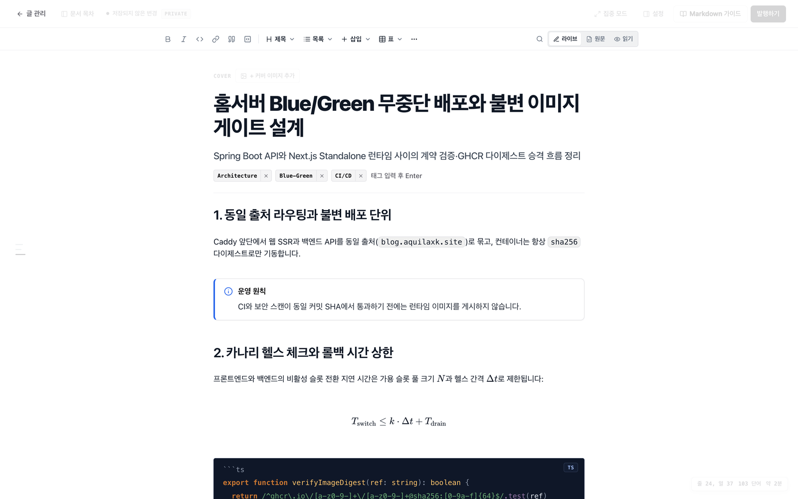
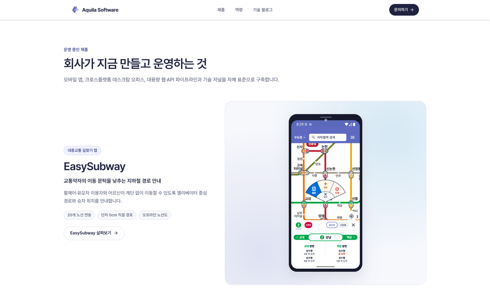

<p align="center">
  
</p>

<h1 align="center">Aquila Blog Web</h1>

<p align="center">
  <strong>기술 블로그, 라이브 마크다운 에디터 스튜디오, 제품·회사 표면을 함께 서빙하는 Next.js 웹 앱</strong>
  <br />
  Next.js 15.5(Pages Router) · React 19.2 · TypeScript 5 · Emotion · TanStack Query v5 · CodeMirror 6
  <br />
  <a href="https://blog.aquilaxk.site"><b>blog.aquilaxk.site에서 바로 보기 ↗</b></a>
</p>

<p align="center">
  
</p>

<p align="center">
  <a href="https://github.com/AquilaXk/aquila-blog-web/actions/workflows/ci.yml"></a>
  <a href="https://github.com/AquilaXk/aquila-blog-web/actions/workflows/security.yml"></a>
  <a href="LICENSE"></a>
  
  <a href="https://github.com/sponsors/AquilaXk"></a>
</p>

<p align="center">
  <a href="https://blog.aquilaxk.site"><b>블로그</b></a> ·
  <a href="https://www.aquilaxk.site"><b>Aquila Software</b></a> ·
  <a href="#주요-기능"><b>주요 기능</b></a> ·
  <a href="#주요-화면"><b>주요 화면</b></a> ·
  <a href="#빠른-시작"><b>빠른 시작</b></a> ·
  <a href="#문서"><b>문서</b></a> ·
  <a href="https://github.com/AquilaXk/aquila-blog"><b>Platform 저장소 ↗</b></a>
</p>

`Aquila Blog Web`은 [blog.aquilaxk.site](https://blog.aquilaxk.site)(블로그), [www.aquilaxk.site](https://www.aquilaxk.site)(Aquila Software · 다운로드), [easysubway.aquilaxk.site](https://easysubway.aquilaxk.site)의 UI와 SSR 프록시 계층을 소유하는 저장소입니다. 백엔드 API, 데이터베이스, 홈서버 인프라, 공개 API 계약 정본 생성은 [AquilaXk/aquila-blog](https://github.com/AquilaXk/aquila-blog)이 맡습니다. 이 저장소는 계약 스냅샷(`contracts/platform/manifest.lock.json`)을 타입으로 가져와 드리프트를 검증합니다.

## 주요 기능

- **기술 블로그와 아카이브** (`/`, `/posts/[id]`, `/about`) — 커서 기반 피드 탐색, 주제·태그 필터, 연재 시리즈 네비게이션, 목차, KaTeX 수식, Mermaid 다이어그램, 코드 블록, 커스텀 디렉티브(`:::callout`, `:::toggle`, `:::bookmark`, `:::embed`, `:::file`)를 에디터와 상세 페이지에서 동일하게 렌더링합니다.
- **라이브 마크다운 에디터 스튜디오** (`/admin/editor/new`, `/admin/editor/[id]`) — CodeMirror 6 증분 라이브 프리뷰, 4가지 보기 전환(라이브·분할·원문·읽기)과 스크롤 동기화, `/` 슬래시 명령, 블록 드래그 핸들, 링크 버블 팝오버, 코드 언어 선택기·복사, 이미지 크기·정렬 제어, URL 언펄, `[[...]]` 위키링크 자동완성과 한/영 UI를 제공합니다.
- **임시초안·발행 파이프라인** — 다중 서버 임시초안과 로컬 브라우저 초안 복구, 발행 준비도 점검, 리비전 차분(Diff) 비교, 예약 발행, 연재 시리즈 편성, 정본 URL 설정, 커버 이미지 초점 조정을 한 작업 공간에서 처리합니다.
- **관리자·클라우드 워크스페이스** (`/admin`, `/admin/posts`, `/admin/profile`, `/admin/cloud`, `/admin/tools`) — 단일 관리자 이메일 코드 인증, 게시글 일괄 관리, 프로필 워크스페이스 편집·발행, 클라우드 멀티파트 이어올리기·서명된 공유·외부 재생 링크 관리, 운영 진단 도구를 지원합니다.
- **제품·서비스 쇼케이스와 다운로드** (`/company`, `/download`, `/easysubway`) — Aquila Software 소개 화면과 EasyOffice·EasySubway·EasyConvert 안내, EasyOffice 최신 릴리스(`latest.json`, `SHA256SUMS.txt`) 연동을 단일 컨테이너 이미지로 서빙합니다.
- **Fail-Closed 보안과 정적·성능 가드** — 사설 IPv4/IPv6 차단 URL 언펄, 이미지 매직바이트·차원 선검증, 600줄·레이어 경계, 라이트 전용 토큰, 번들 크기·런타임 이미지 페이로드 예산, 계약 드리프트 검사를 CI에서 강제합니다.

## 주요 화면

<table>
<tr>
<td width="42%" valign="middle">

### 마크다운 에디터 스튜디오

라이브·분할·원문·읽기 4가지 보기를 오가며 글을 씁니다. 슬래시 명령, 블록 드래그, 수식·콜아웃, `[[위키링크]]`, 다중 임시초안, 리비전 Diff, 예약·시리즈 발행까지 한 화면에서 이어집니다.

</td>
<td width="58%">
  
</td>
</tr>
<tr>
<td width="42%" valign="middle">

### 제품·서비스 쇼케이스

`www.aquilaxk.site`와 `easysubway.aquilaxk.site` 표면을 같은 standalone 이미지로 서빙합니다. EasySubway, EasyOffice, EasyConvert 소개와 EasyOffice 최신 릴리스·SHA-256 체크섬 검증 안내를 연결합니다.

</td>
<td width="58%">
  
</td>
</tr>
</table>

## 빠른 시작

로컬 실행에는 **Node.js `>=20.19`**(권장 `20 LTS`, [`.nvmrc`](.nvmrc))와 **Yarn `1.22.22`**가 필요합니다. `.env.local` 또는 환경변수로 `NEXT_PUBLIC_BACKEND_URL`과 `BACKEND_INTERNAL_URL`을 지정해 백엔드 API와 연결합니다.

```sh
yarn install --frozen-lockfile   # 의존성 설치
yarn dev                         # 로컬 개발 서버 실행 (http://localhost:3000)
yarn build                       # 프로덕션 standalone 빌드
```

<details>
<summary><b>플랫폼 공개 API 계약 동기화</b></summary>

플랫폼 저장소([`AquilaXk/aquila-blog`](https://github.com/AquilaXk/aquila-blog))에서 공개 API 계약이 갱신되면 아래 순서로 스냅샷과 TypeScript 타입을 맞춥니다. 배포 환경에서는 `sync-public-contract-to-web.yml`이 변경을 전달하면 웹 `main` 브랜치에 fast-forward로 자동 반영됩니다.

```sh
yarn contracts:import:local      # 로컬 플랫폼 저장소 계약 가져오기
yarn contracts:generate          # OpenAPI TypeScript 정의 생성
yarn contracts:check             # 매니페스트 및 계약 드리프트 검증
```

</details>

<details>
<summary><b>품질·보안·E2E 검증 명령</b></summary>

```sh
node scripts/repo-boundary/check-web-root.mjs
node scripts/repo-boundary/check-web-boundary.mjs
yarn lint
yarn type-check
yarn check:refactor-boundaries
yarn check:design-colors
yarn contracts:check
yarn test:unit
yarn test:storybook:smoke
```

렌더링·정적 자산·번들 변경 시에는 아래 명령으로 회귀와 이미지 용량 예산을 함께 검증합니다.

```sh
yarn build && yarn check:bundle-size && yarn check:runtime-image-payload && yarn test:e2e:smoke
```

</details>

<details>
<summary><b>저장소 구조</b></summary>

```
aquila-blog-web/
├── src/
│   ├── pages/                   # Next.js Pages Router 진입점 및 SSR/API 라우트
│   ├── routes/                  # Feed, Detail, About, Admin, Company, EasySubway 모듈
│   ├── components/
│   │   └── markdown-editor/     # CodeMirror 6 라이브 프리뷰·툴바·위젯
│   ├── libs/markdown/           # 단일 스펙 마크다운 렌더러·수식·센티넬 가드
│   ├── design-system/           # 라이트 전용 UI 토큰·공통 컴포넌트
│   └── apis/                    # 백엔드 API 클라이언트 및 정책 레지스트리
├── packages/shared-contracts/   # 생성된 OpenAPI TypeScript 계약 패키지
├── contracts/platform/          # 플랫폼 공개 API 계약 스냅샷 및 잠금 파일
├── public/                      # 브랜드 마스코트·파비콘·정적 자산
├── scripts/                     # 경계·색상·번들·페이로드·계약 검증 스크립트
├── tests/                       # 단위 테스트
├── e2e/                         # Playwright 스모크·에디터·접근성·CSP 테스트
└── Dockerfile.runtime           # Next.js standalone 운영 컨테이너 이미지
```

</details>

## 문서

- [프론트엔드 작업 가이드](docs/design/Frontend-Working-Guide.md): SSR 에러 처리 결정 트리 및 구현 경계
- [마크다운 에디터·렌더러 결정 기록](docs/design/markdown-editor-and-renderer-decisions.md): 2패스 CommonMark 마스킹, 수식 경계, 센티넬 프로빙, CodeMirror 6 설계
- [패밀리 룩 가이드](docs/design/family-look-guide.md): 공개 표면·디자인 토큰 정합성 기준
- [보안 CSP 롤아웃](docs/design/security-csp-rollout.md): Content-Security-Policy 정책 및 검증 기준
- [릴리스 UI QA 매트릭스](docs/design/release-ui-qa-matrix.md): 화면별 릴리스 품질 점검 항목
- [웹 릴리스 런북](docs/operations/web-release.md): 홈서버 배포 승격 검증 절차
- [웹 롤백 런북](docs/operations/web-rollback.md): 이전 불변 이미지 다이제스트 복구 절차

## 문제 신고

버그는 [이슈 양식](https://github.com/AquilaXk/aquila-blog-web/issues/new/choose)으로 신고해 주세요. 기능 요청과 PR은 받지 않습니다. 보안 취약점은 공개 이슈 대신 [SECURITY.md](SECURITY.md)의 비공개 제보 경로로 알려 주세요.

## 후원

Aquila Blog Web은 무료 오픈소스입니다. 후원금은 개발 시간과 테스트·홈서버 운영 비용에 쓰입니다. [github.com/sponsors/AquilaXk](https://github.com/sponsors/AquilaXk)

### 후원해 주신 분들

아직 없습니다 — [후원하기](https://github.com/sponsors/AquilaXk)

## 라이선스

가져다 쓴 코드의 출처와 라이선스는 [THIRD_PARTY_NOTICES.md](THIRD_PARTY_NOTICES.md)에 있습니다. 블로그 본문과 미디어 콘텐츠([blog.aquilaxk.site](https://blog.aquilaxk.site))는 [CC BY 4.0](https://creativecommons.org/licenses/by/4.0/)을 따릅니다.

이 프로젝트 자체 코드는 [MIT](LICENSE) 라이선스로 배포합니다.
